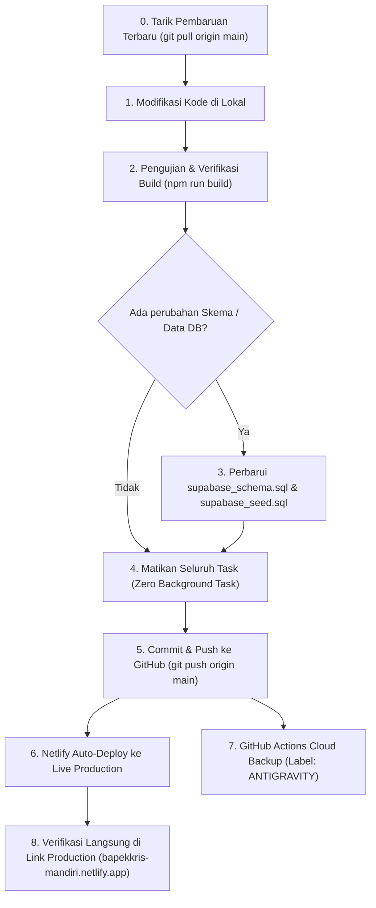

# Standar Kerja & Protokol Operasional (SOP) Official Website Bapekkris Bank Mandiri

Dokumen ini merupakan panduan standar operasional baku bagi pengembang dan agen AI (Antigravity) dalam mengelola, mengembangkan, dan memelihara ekosistem aplikasi Bapekkris (Badan Pembinaan Kerohanian Kristen) PT Bank Mandiri (Persero) Tbk.

---

## 1. Arsitektur Konektivitas & Aliran Data

| Platform / Komponen | Peran & Sumber | Endpoint / URL | Status Terhubung |
| :--- | :--- | :--- | :--- |
| **Local Machine** | Verifikasi build lokal (`npm run build`) | Workspace Lokal | Aktif (Offline/Lokal, Zero Background Task) |
| **GitHub Cloud** | *Single Source of Truth* repositori & runner CI/CD | `https://github.com/gahasapurba/bapekkris-web.git` | Terhubung langsung (Remote: `origin/main`) |
| **Netlify (Production)** | Production Web Hosting & Edge Network (Auto-deploy dari GitHub) | `https://bapekkris-mandiri.netlify.app` | **Single Source of Truth untuk Peninjauan UI & Fitur Live** |
| **Supabase Cloud** | Backend Database (PostgreSQL 16) & Media Storage (`bapekkris-media`) | `https://zkvjudumhhnwxchhakjl.supabase.co` | Terhubung aktif (REST & Storage API) |

---

## 2. Standar Siklus Pengembangan (Development Lifecycle) & Sinkronisasi Multi-Device

Proyek ini dikembangkan secara fleksibel lintas perangkat (misal: laptop kerja dan laptop pribadi di rumah) dengan **GitHub (`origin/main`) sebagai Single Source of Truth**. Oleh karena itu, siklus pengembangan wajib mengikuti alur sinkronisasi berikut:

> [!IMPORTANT]
> **Aturan Wajib Multi-Device (Selalu Pull Sebelum Mulai)**:
> - **Sebelum memulai pekerjaan/sesi baru**: Agen dan pengembang **WAJIB selalu mengeksekusi `git pull origin main`** terlebih dahulu. Hal ini menjamin pekerjaan selalu berbasis commit terbaru yang mungkin baru saja di-push dari perangkat/laptop lain.
> - **Kondisi Branch Bersih**: Selalu pastikan branch lokal `main` telah up-to-date dengan `origin/main` sebelum melakukan perubahan kode apa pun.

---

## 3. Kewajiban Pembaruan 3 Pilar Setiap Perubahan (Update Schema, Seed, dan Backup di GitHub)

Setiap kali melakukan perubahan, penambahan fitur, perbaikan bug, pembaruan skema, atau modifikasi data pada proyek Bapekkris Bank Mandiri, Antigravity **WAJIB selalu memperbarui 3 hal berikut**:

1. **Perbarui `supabase_schema.sql` (Master Blueprint DDL)**:
   - Wajib selalu diperbarui dan diselaraskan setiap ada penambahan tabel baru, penambahan kolom baru, perubahan tipe data, constraint, relasi foreign key, indeks, maupun aturan RLS & Storage policies.
   - Harus selalu idempotent (`CREATE TABLE IF NOT EXISTS`, `ALTER TABLE ... ADD COLUMN IF NOT EXISTS`) sehingga aman dijalankan kapan saja untuk recovery.

2. **Perbarui `supabase_seed.sql` (Master Data Blueprint)**:
   - Wajib disinkronkan dengan struktur data master terbaru.
   - Sesuai prinsip **Zero Mock Data**, berkas seed berfungsi sebagai blueprint inisialisasi yang murni bersih dan idempotent (`ON CONFLICT DO NOTHING`).

3. **Backup Otomatis di GitHub (Cloud Backup, Bebas Beban Disk Lokal)**:
   - **DILARANG menyimpan berkas backup (.zip / .json) di penyimpanan komputer lokal** agar kapasitas disk lokal pengguna tetap bersih dan tidak berkurang.
   - File backup dieksekusi dan disimpan secara aman di **GitHub Actions Cloud Artifacts**.
   - Setiap kali `supabase_schema.sql` atau `supabase_seed.sql` di-commit & di-push ke GitHub, GitHub Actions otomatis memicu full backup database + storage fisik.
   - Dilengkapi sistem penandaan otomatis (*labeling artifact*):
     - **`supabase-backup-ANTIGRAVITY-...`**: Dijalankan otomatis oleh Antigravity AI pasca perubahan skema/seed.
     - **`supabase-backup-SYSTEM-...`**: Dijalankan otomatis oleh sistem terjadwal setiap hari pukul 02:00 WIB.
     - **`supabase-backup-MANUAL-...`**: Dijalankan manual oleh pengguna melalui menu Actions di GitHub.

---

## 4. Kebijakan Zero Background Task (Wajib Mati Semua Setelah Digunakan)

Antigravity **WAJIB memastikan seluruh background task MATI TOTAL setelah digunakan**:
- **Tidak Boleh Ada Task Menggantung**: Tidak ada dev server lokal (`npm run dev`), compiler, watcher, ataupun daemon process yang dibiarkan tetap berjalan di background setelah respon selesai.
- **Segera Dihentikan (*Killed*)**: Segala task pengujian sementara, print-to-pdf, build check, atau CLI process **wajib segera di-kill** begitu tugasnya selesai.
- **Beban Memori & CPU Bersih**: Kondisi akhir di setiap akhir giliran harus selalu menunjukkan status background task aktif: **0 (Nol)**.

---

## 5. Standar Verifikasi Langsung di Link Production (Live Web Review)

Untuk melihat dan memverifikasi setiap hasil perubahan kode, fitur, tampilan visual, maupun tata letak:
- **Verifikasi Langsung di Link Prod**: Peninjauan hasil dilakukan langsung pada URL live production:
  👉 **[https://bapekkris-mandiri.netlify.app](https://bapekkris-mandiri.netlify.app)**
- **Auto-Deployment Netlify**: Setiap commit yang di-push ke branch `main` di GitHub otomatis memicu build & publish pada Netlify dalam ~1-2 menit.
- **Pengecekan Responsivitas**: Pengguna dan agen meninjau tampilan desktop maupun tampilan mobile langsung melalui browser pada link production tersebut.

---

## 6. Ambang Batas Kapasitas & Early Warning (Supabase Free Tier)

| Metrik | Batas Kuota Free | Warning Threshold | Critical Threshold | Tindakan Pencegahan |
| :--- | :---: | :---: | :---: | :--- |
| **Database** | 500 MB | 350 MB | 450 MB | Arsip log aspirasi/RSVP lawas |
| **Storage Bucket** | 1.000 MB (1 GB) | 400 MB | 800 MB | Kompresi WebP gambar gallery/member |

---

## 7. Standar Pelaporan Wajib Agen AI (Mandatory Reporting Protocol)

Setiap kali Antigravity menyelesaikan perubahan, pembaruan fitur, skema/seed, atau permintaan pengguna, Antigravity **WAJIB** menyertakan 5 bagian laporan berikut secara lengkap:

1. **Status Konektivitas ("Sekarang Kamu Terhubung ke Mana")**:
   - Memetakan koneksi aktif (GitHub Cloud `origin`, Netlify Production, dan Supabase Cloud).
2. **Tabel Rangkuman Status 4 Pilar Ekosistem**:
   - Local Machine, GitHub Cloud, Netlify Production, dan Supabase Cloud.
3. **Status 3 Pilar Sinkronisasi (Schema, Seed, dan Backup Cloud)**:
   - `supabase_schema.sql`, `supabase_seed.sql`, dan status GitHub Actions Cloud Backup.
4. **Tautan Verifikasi Live Production**:
   - Tautan langsung ke `https://bapekkris-mandiri.netlify.app` beserta ringkasan apa saja yang dapat langsung dicek di halaman produksi.
5. **Audit Status Background Task (Zero Running Tasks)**:
   - Konfirmasi bahwa seluruh background task telah **mati total (0 task aktif)** dan beban sistem telah bersih.

